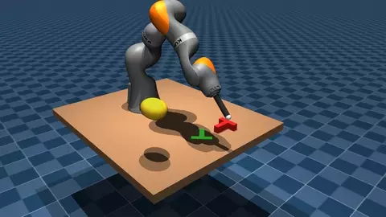
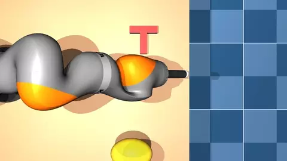
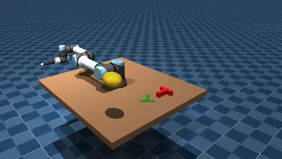
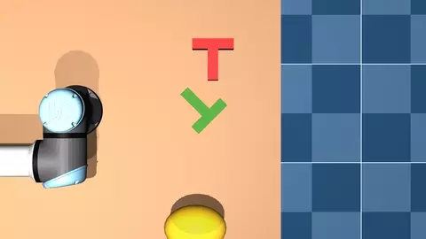

# LiRA — Lightweight Reactive Arm control

Plan once offline, then react live. LiRA plans a collision-free joint-space path for a robot
arm (gradient descent or trust-region SQP), turns it into a stable velocity field, and filters
that field every control tick with a CBF-QP against self-collision, the table, objects and
moving obstacles. It runs on a UR5e and a KUKA iiwa14 in MuJoCo.

The code, and how to run it, is in [lira/](lira/readme.md).

```
git clone --recursive git@github.com:davintjan/lira.git
```

## Push-T demo

| | Front | Top |
|---|---|---|
| iiwa14 |  |  |
| UR5e |  |  |

In these videos the arm plays Push-T with the diffusion policy checkpoint from the original paper,
used as is with no retraining. Each run starts with the arm away from the table, so we first plan a
path with SQP to bring it into the workspace. Once it gets there, the policy takes over.

While the policy is running, its actions go through a DS-based controller. The controller follows
what the policy wants to do and also moves the arm out of the way of the obstacle. The robot only
knows where the obstacle is at the current moment. It doesn't know where the obstacle is heading or
how fast it's moving, so all of the dodging is a reaction to where the obstacle is right now.

This isn't vision-based yet. The robot gets the exact pose of the T straight from the simulator
instead of estimating it from a camera.
